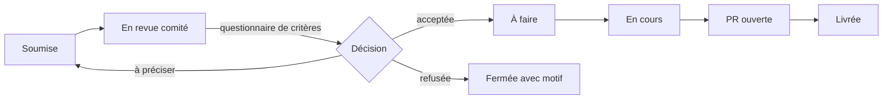

# Eugenia School · Refonte du site, appli interne et cursus

> **Statut : brouillon v0.1.** Les éléments marqués **[H]** sont des hypothèses de travail à valider par le comité. Les éléments marqués **[À COMPLÉTER]** attendent une information.

Ce dépôt public regroupe trois chantiers menés en parallèle par la communauté Eugenia School (équipe, intervenants, élèves) : le site public, l'application interne et le référentiel des cursus. Chaque chantier vit sur sa propre branche. La branche `main` ne contient que la documentation commune.

---

## Sommaire

1. [Par où commencer](#1-par-où-commencer)
2. [Organisation des branches](#2-organisation-des-branches)
3. [Architecture de `site-main`](#3-architecture-de-site-main)
4. [Architecture de `appli-main`](#4-architecture-de-appli-main)
5. [Architecture de `cursus-main`](#5-architecture-de-cursus-main)
6. [Pile technique](#6-pile-technique)
7. [Proposer une idée : cycle de vie d'une issue](#7-proposer-une-idée--cycle-de-vie-dune-issue)
8. [RGPD et sécurité](#8-rgpd-et-sécurité)
9. [Gouvernance](#9-gouvernance)
10. [Licence](#10-licence)
11. [Glossaire](#11-glossaire)
12. [Points ouverts](#12-points-ouverts)

---

## 1. Par où commencer

| Vous êtes | Vous voulez | Allez vers |
|---|---|---|
| Élève | Proposer une amélioration du site ou de l'appli | [Section 7](#7-proposer-une-idée--cycle-de-vie-dune-issue), puis l'onglet **Issues** |
| Élève ou intervenant | Corriger un texte du site | Branche `site-dev`, puis [CONTRIBUTING.md](CONTRIBUTING.md) |
| Développeur | Travailler sur l'appli | Branche `appli-dev`, [section 4](#4-architecture-de-appli-main) |
| Responsable pédagogique, intervenant | Faire évoluer un module de cours | Branche `cursus-dev`, [section 5](#5-architecture-de-cursus-main) |
| Membre du comité | Trier les idées | [Section 9](#9-gouvernance) |

Toute contribution passe par une *pull request* (PR, demande de fusion). Personne ne pousse directement sur une branche `*-main`.

---

## 2. Organisation des branches

```
main                     README.md, CONTRIBUTING.md, gouvernance, modèles d'issues
│
├── site-main            version publiée du site
│   └── site-dev         intégration des contributions site
│       └── site/<sujet>     branches de travail individuelles
│
├── appli-main           version en production de l'application interne
│   └── appli-dev
│       └── appli/<sujet>
│
└── cursus-main          référentiel pédagogique validé
    └── cursus-dev
        └── cursus/<sujet>
```

### Règles

| Branche | Qui peut fusionner | Revue exigée | Contrôles automatiques |
|---|---|---|---|
| `main` | Comité | 2 approbations [H] | Liens Markdown valides |
| `site-main` | Mainteneurs site | 1 approbation + propriétaire de code | Build du site |
| `appli-main` | Mainteneurs appli | 2 approbations [H] | Tests, lint, analyse des secrets |
| `cursus-main` | Responsable pédagogique | Responsable pédagogique obligatoire | Contrôle de conformité au titre (voir 5.3) |
| `*-dev` | Mainteneurs du chantier | 1 approbation | Identiques à la branche `*-main` correspondante |

### Points d'attention

- **Le dépôt est public : tout le monde lit toutes les branches.** La différence d'accès entre chantiers porte uniquement sur le droit de fusionner, appliqué par les règles de protection de branche (*rulesets*) et un fichier `CODEOWNERS`.
- Les branches `*-main` ne sont **jamais fusionnées dans `main`**. Elles ont chacune leur propre historique. Une modification de documentation commune se fait par PR vers `main`.
- GitHub lit le fichier `CODEOWNERS` sur la branche cible de la PR **[à vérifier dans la documentation GitHub]** : chaque branche `*-main` et `*-dev` porte donc son propre `CODEOWNERS`.
- Nommage des branches de travail : `<chantier>/<numéro-issue>-<description-courte>`, par exemple `site/42-page-admissions`.

---

## 3. Architecture de `site-main`

Site public de l'école, généré statiquement à partir de fichiers Markdown **[H]**. Ce choix permet à tout contributeur de modifier un texte par PR sans toucher au code.

```
site-main/
├── CODEOWNERS
├── README.md                 lancer le site en local
├── contenu/                  textes éditables par PR
│   ├── accueil.md
│   ├── ecole/                présentation, équipe, partenaires
│   ├── formations/           pages générées depuis cursus-main (voir ci-dessous)
│   ├── admissions/
│   ├── vie-etudiante/
│   └── mentions-legales/     mentions légales, politique de confidentialité, cookies
├── medias/                   images libres de droits ou propriété de l'école
├── src/                      gabarits et composants [framework à choisir]
└── .github/workflows/        build, vérification des liens, déploiement
```

**Lien avec le cursus.** Les pages `contenu/formations/` sont produites automatiquement à partir des fiches de `cursus-main` au moment du build **[H]**. Le cursus reste ainsi la source unique de vérité : un volume horaire modifié dans `cursus-main` se répercute sur le site sans double saisie.

---

## 4. Architecture de `appli-main`

Une seule application, deux rôles :

| Rôle | Accès |
|---|---|
| **Élève** | Apprendre, Ressources, Cursus (lecture), soumission d'idées, questionnaires |
| **Interne** (équipe, intervenants) | Tout ce qui précède + gestion des contenus, retours de cours, espace intervenants |

### Modules fonctionnels

```
Appli
├── Idées (Issues)          formulaire de soumission relié aux Issues GitHub
├── Apprendre               parcours, exercices
├── Ressources
│   ├── enregistrements     enregistrements de cours
│   ├── slides
│   └── liens
├── Cursus                  affichage du référentiel de cursus-main
└── Intervenants            rôle interne uniquement
    ├── questionnaire élèves avant le cours
    └── retours de cours (feedback)
```

### Arborescence du code

```
appli-main/
├── CODEOWNERS
├── README.md                 installation locale, variables d'environnement
├── src/                      application [framework à choisir]
├── supabase/
│   ├── migrations/           schéma versionné de la base
│   ├── policies/             règles RLS, une par table
│   └── seed.sql              données FICTIVES uniquement
├── n8n/
│   └── workflows/            workflows exportés en JSON, SANS identifiants
├── docs/
│   ├── architecture.md
│   ├── roles-et-droits.md    matrice rôle × table × opération
│   └── rgpd/                 documentation technique des traitements (section 8)
├── .env.example              noms des variables, aucune valeur réelle
└── .github/workflows/        tests, lint, analyse des secrets
```

---

## 5. Architecture de `cursus-main`

Référentiel pédagogique de l'école et processus liés aux intervenants. Validé par le responsable pédagogique.

### 5.1 Arborescence

```
cursus-main/
├── CODEOWNERS                       responsable pédagogique sur tout le dossier
├── diplomes/
│   ├── bachelor-ai-applied-to-business/
│   │   ├── titre.md                 fiche d'identité du titre (voir 5.2)
│   │   ├── b1/
│   │   │   └── modules/
│   │   │       └── <code-module>.md
│   │   ├── b2/
│   │   └── b3/
│   ├── master-ai-applied-to-business/
│   │   ├── titre.md
│   │   ├── m1/
│   │   └── m2/
│   └── _modele-nouveau-diplome/     à copier pour un futur diplôme
├── conformite/
│   ├── matrice.md                   générée : module × bloc de compétences × heures
│   └── regles.yml                   seuils issus du dossier du titre [À COMPLÉTER]
└── intervenants/
    ├── recrutement/
    │   ├── processus.md
    │   └── grille-entretien.md      MODÈLE vierge uniquement
    ├── onboarding/
    │   └── parcours.md
    ├── conditions-et-modeles/       modèles de documents, sans données nominatives
    ├── questionnaire-pre-cours/     modèle du questionnaire envoyé aux élèves
    └── retours-de-cours/            modèle du formulaire de feedback
```

### 5.2 Fiche d'identité d'un titre (`titre.md`)

```yaml
intitule_officiel: "[À COMPLÉTER]"
code_rncp: "[À COMPLÉTER]"           # ex. RNCPxxxxx
niveau: "[À COMPLÉTER]"              # niveau du cadre national des certifications
certificateur: "[À COMPLÉTER]"       # l'école ou un organisme partenaire
date_fin_enregistrement: "[À COMPLÉTER]"
lien_fiche: "[À COMPLÉTER]"          # fiche sur francecompetences.fr
blocs_de_competences:
  - code: "[À COMPLÉTER]"
    intitule: "[À COMPLÉTER]"
```

### 5.3 Fiche module et contrôle de conformité

Chaque module porte un en-tête structuré :

```yaml
code: B1-XXX-01
intitule: "..."
diplome: bachelor-ai-applied-to-business
annee: B1
semestre: 1
volume_horaire_h: 30
blocs_rncp: [BC01]
modalite_evaluation: "..."
responsable: "<rôle, pas de nom>"
version: 1.0.0
```

Une action GitHub lit tous les en-têtes, régénère `conformite/matrice.md` et **bloque la PR** si un bloc de compétences n'est plus couvert ou si un seuil défini dans `regles.yml` n'est plus respecté.

**Limite à connaître.** La fiche RNCP publique décrit principalement les blocs de compétences et les modalités d'évaluation. Les volumes horaires et la répartition par matière relèvent plutôt du dossier de l'école et de son référentiel de formation **[à vérifier auprès du responsable pédagogique]**. Les seuils de `regles.yml` doivent provenir de ces documents, pas d'une estimation.

**Ne jamais publier ici :** sujets d'examen, grilles de correction confidentielles, résultats d'élèves.

---

## 6. Pile technique

| Outil | Rôle | Statut |
|---|---|---|
| GitHub | Code, contenus, idées (Issues), revue, automatisations (Actions) | Retenu |
| Supabase | Base de données PostgreSQL, authentification, stockage de fichiers | Retenu |
| n8n | Automatisations : formulaire d'idées vers Issues, envoi des questionnaires, notifications | Retenu |
| [nom à confirmer, « router » ?] | [rôle à préciser] | [À COMPLÉTER] |
| Framework du site | Génération statique depuis Markdown | [À CHOISIR] |
| Framework de l'appli | Interface élèves et interne | [À CHOISIR] |
| Hébergement | Site, appli, instance n8n | [À CHOISIR] |

---

## 7. Proposer une idée : cycle de vie d'une issue

### Deux portes d'entrée

1. **Depuis l'appli (recommandé pour les élèves) [H]** : formulaire dans le module Idées, transmis par n8n, qui crée l'issue sous un compte technique. Le nom de l'élève n'apparaît pas publiquement.
2. **Directement sur GitHub** : onglet Issues, choisir le modèle correspondant au chantier. Votre compte GitHub sera visible publiquement.

### Étapes



### Étiquettes (labels)

| Famille | Valeurs |
|---|---|
| Chantier | `chantier:site`, `chantier:appli`, `chantier:cursus`, `chantier:commun` |
| Statut | `statut:soumise`, `statut:en-revue`, `statut:acceptee`, `statut:refusee`, `statut:en-cours`, `statut:livree` |
| Type | `type:idee`, `type:bug`, `type:contenu`, `type:rgpd` |

Un refus est toujours motivé dans l'issue, en référence aux critères du questionnaire du comité **[À COMPLÉTER : lien vers le questionnaire]**.

---

## 8. RGPD et sécurité

### 8.1 Règles absolues du dépôt

1. **Aucune donnée personnelle réelle dans le dépôt**, sur aucune branche : ni nom d'élève, ni adresse e-mail, ni réponse à un questionnaire, ni candidature d'intervenant, ni note. Les jeux de test utilisent des données fictives.
2. **Aucun secret** (clé d'API, mot de passe, jeton, URL de base avec identifiants). Les secrets vivent dans les *GitHub Secrets* et dans les variables d'environnement des hébergeurs. L'analyse des secrets et la protection à la poussée (*push protection*) sont activées sur le dépôt.
3. **Workflows n8n exportés sans identifiants.**
4. **Historique Git** : une donnée poussée par erreur reste dans l'historique après suppression. Tout incident est signalé immédiatement au référent RGPD (voir 8.5), qui décide de la purge et de la révocation des secrets concernés.

### 8.2 Protection des données dans l'appli

- Sécurité au niveau des lignes (*Row Level Security*, RLS) activée sur **toutes** les tables Supabase, sans exception.
- Moindre privilège : la matrice `appli-main/docs/roles-et-droits.md` décrit, pour chaque rôle, les tables et opérations autorisées.
- La clé de service Supabase n'est jamais utilisée côté navigateur.
- Région d'hébergement des données dans l'Union européenne [H, à vérifier pour chaque fournisseur].

### 8.3 Traitements prévus

Ce tableau sert de base au registre des traitements (article 30 du RGPD), tenu **hors du dépôt** par le référent RGPD.

| Traitement | Personnes concernées | Données | Finalité | Base légale | Durée de conservation |
|---|---|---|---|---|---|
| Comptes de l'appli | Élèves, équipe | Identité, e-mail, rôle | Accès à l'appli | [À DÉTERMINER] | [À DÉTERMINER] |
| Questionnaire avant cours | Élèves | Réponses | Adapter le cours | [À DÉTERMINER] | [À DÉTERMINER] |
| Retours de cours | Élèves, intervenants | Évaluations, commentaires | Qualité pédagogique | [À DÉTERMINER] | [À DÉTERMINER] |
| Enregistrements de cours | Intervenants, élèves visibles ou audibles | Image, voix | Ressources pédagogiques | [À DÉTERMINER] | [À DÉTERMINER] |
| Soumission d'idées | Élèves, contributeurs | Pseudonyme ou compte GitHub, contenu | Amélioration des outils | [À DÉTERMINER] | [À DÉTERMINER] |
| Recrutement d'intervenants | Candidats | CV, notes d'entretien | Recrutement | [À DÉTERMINER] | [À DÉTERMINER] |

### 8.4 Sous-traitants et transferts

| Fournisseur | Usage | Localisation des données | Encadrement des transferts hors UE |
|---|---|---|---|
| GitHub | Code, issues publiques | [À VÉRIFIER] | [À VÉRIFIER] |
| Supabase | Base, authentification, fichiers | [À VÉRIFIER] | [À VÉRIFIER] |
| Hébergeur n8n | Automatisations | [À VÉRIFIER] | [À VÉRIFIER] |
| [router à confirmer] | [À COMPLÉTER] | [À VÉRIFIER] | [À VÉRIFIER] |

### 8.5 Contact et droits des personnes

Référent RGPD du projet : [À COMPLÉTER]. Pour exercer vos droits (accès, rectification, effacement, opposition) : [À COMPLÉTER].

---

## 9. Gouvernance

- **Comité** : [membres à compléter]. Il trie les issues, arbitre les désaccords et fait évoluer ce README.
- **Mainteneurs par chantier** : site [À COMPLÉTER], appli [À COMPLÉTER], cursus : responsable pédagogique.
- **Critères d'acceptation des idées** : définis par le questionnaire du comité [lien à venir].
- **Évolution de ce document** : par PR vers `main`, validée par le comité.

---

## 10. Licence

**[À DÉFINIR].** Tant qu'aucune licence n'est publiée, le contenu du dépôt n'est pas réutilisable par des tiers malgré son caractère public, et le statut juridique des contributions reçues reste flou. Voir [section 12](#12-points-ouverts).

---

## 11. Glossaire

| Terme | Définition |
|---|---|
| Branche | Ligne de travail parallèle dans Git |
| PR (*pull request*) | Demande de fusion d'une branche dans une autre, avec revue |
| Issue | Ticket GitHub : idée, bug ou demande |
| `CODEOWNERS` | Fichier désignant les personnes dont la revue est obligatoire pour certains dossiers |
| RNCP | Répertoire national des certifications professionnelles, tenu par France Compétences |
| Bloc de compétences | Sous-ensemble d'un titre RNCP, évalué et validable séparément |
| RLS (*Row Level Security*) | Règles de la base de données limitant les lignes visibles par chaque utilisateur |
| RGPD | Règlement général sur la protection des données (UE 2016/679) |

---

## 12. Points ouverts

- [ ] Codes RNCP, niveaux et certificateurs des deux titres
- [ ] Source des seuils horaires du contrôle de conformité
- [ ] Identité et rôle du quatrième outil de la pile (« router » ?)
- [ ] Frameworks du site et de l'appli, hébergeurs
- [ ] Composition du comité et mainteneurs
- [ ] Questionnaire de critères du comité
- [ ] Licence(s)
- [ ] Bases légales et durées de conservation des traitements
